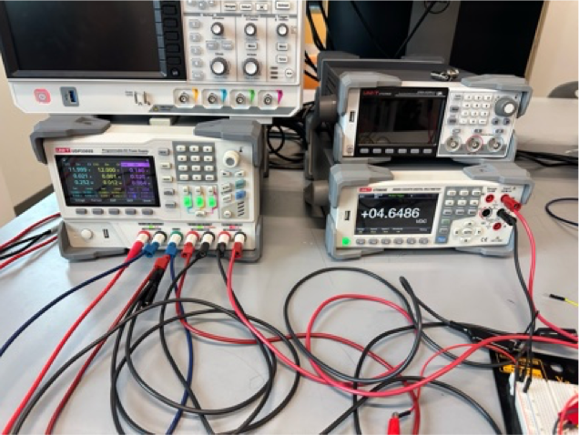
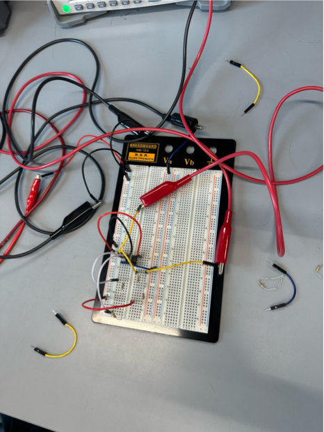
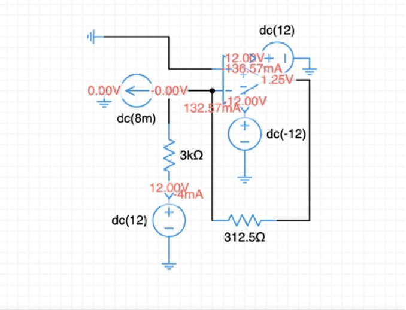
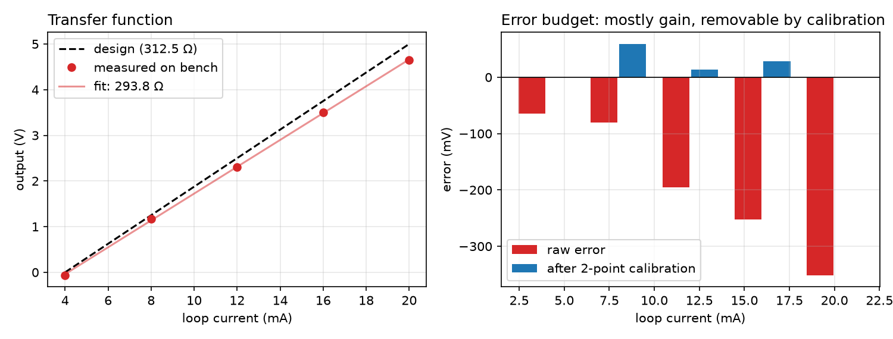

# 4–20 mA current-loop to 0–5 V converter

**Oklahoma State University · ECEN 2714/2011 Circuits I Lab · Fall 2025** · designed, simulated, built and bench-tested

4–20 mA current loops are how industrial sensors (pressure, flow, temperature transmitters, including those on
semiconductor process tools) report readings. Current isn't degraded by long wiring or noise, and 4 mA as
"zero" means a broken wire reads as a fault. A microcontroller or ADC needs a voltage, so this project designed
the interface: a **transimpedance amplifier** that maps 4 mA → 0 V and 20 mA → 5 V.

  
  

*Bench test station (±12 V supplies, DMM reading 4.6486 V at the 20 mA test point) and the breadboarded LM358 circuit.*

## Design
| Requirement | Calculation | Value |
|---|---|---|
| Gain slope | (5 V − 0 V) / (20 mA − 4 mA) | **Rf = 312.5 Ω** |
| Zero at 4 mA | 0 = −(4 mA)(312.5 Ω) + Voffset | **Voffset = 1.25 V**, divider from +12 V |

LM358 op-amp in the inverting TIA configuration, ±12 V rails; Rf built from series/parallel standard values.

## Results: and what the error says
| Input (mA) | Expected (V) | Measured (V) | Error |
|---:|---:|---:|---:|
| 4 | 0.00 | −0.0644 | −64 mV |
| 8 | 1.25 | 1.1695 | −6.4 % |
| 12 | 2.50 | 2.3047 | −7.8 % |
| 16 | 3.75 | 3.4972 | −6.7 % |
| 20 | 5.00 | 4.6486 | −7.0 % |

A least-squares fit of the bench data ([`analyze_measurements.py`](analyze_measurements.py)) splits the error into parts:

- **Gain error −6.0 %:** the circuit's effective transimpedance is **293.8 Ω**, not 312.5 Ω. A consistent percentage
  error at every point is a gain error, not noise. Likely causes are the tolerance stack-up of the series/parallel
  resistors that make up Rf, and the bench current source's calibration.
- **Offset −64 mV** at 4 mA: the offset-divider tolerance plus the LM358's input offset voltage.
- **Nonlinearity only 0.68 % of full scale.** The circuit itself is linear.

So a **two-point calibration** (4 mA and 20 mA) cuts the worst-case error from **7.0 % to 1.2 % of full scale**,
the same approach used to calibrate industrial transmitters. In hardware: trim Rf with a 1 % resistor
plus a potentiometer.

## Files
- [`report.pdf`](report.pdf): full lab report (theory, schematics, procedure, measurements, photos)
- [`analyze_measurements.py`](analyze_measurements.py): error decomposition and calibration analysis

**Skills:** analog design · op-amps (LM358) · transimpedance amplifiers · simulation · breadboard prototyping ·
DMM measurement · error analysis · calibration
