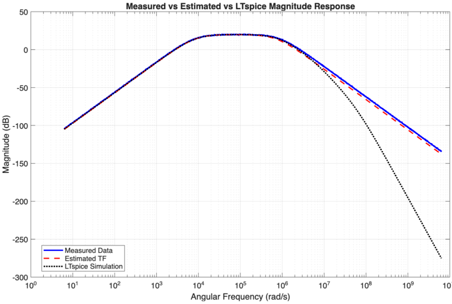
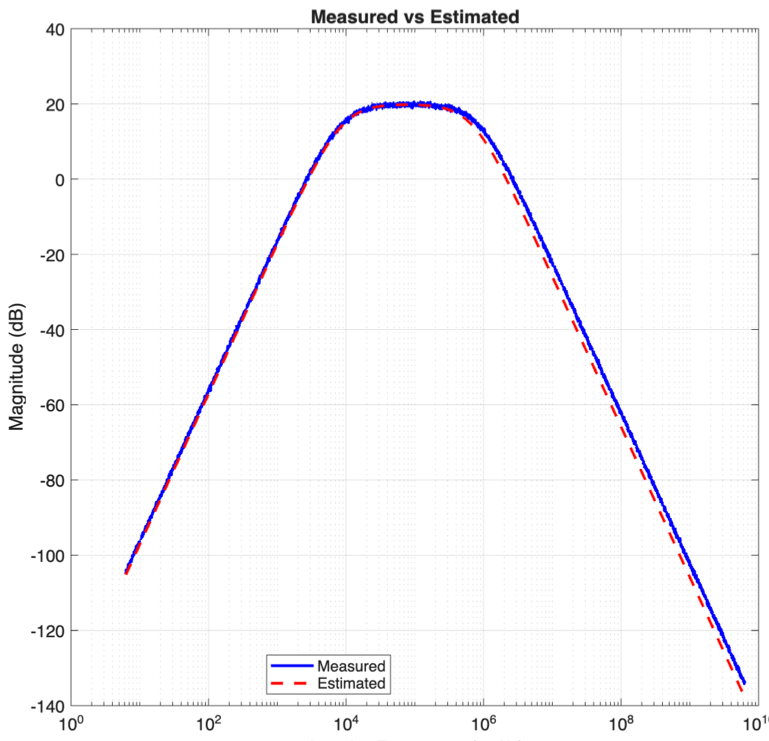
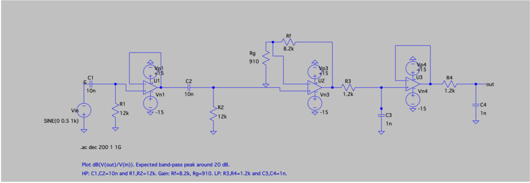

# Band-pass filter: from measured frequency response to a replacement circuit

**Individual project · Spring 2026** · MATLAB, LTspice, IEEE-format report

**The task:** given only the measured frequency response of an unknown part, characterise it, fit a transfer
function, and design a buildable replacement circuit from standard component values. It's the same
measure → model → validate loop used to characterise any device.

## Characterisation (MATLAB)
| Parameter | Value |
|---|---|
| Peak gain | **20.54 dB** (10.65 V/V) at 1.21 × 10⁵ rad/s |
| −3 dB band | 1.32 × 10⁴ – 4.60 × 10⁵ rad/s |
| Skirt slopes | +39.7 dB/dec, −39.7 dB/dec → **2 high-pass + 2 low-pass poles** |
| Fitted model vs measured | **2.37 dB RMS error** |

Fitted transfer function (K = 10, ω₁ = 8.48 × 10³ rad/s, ω₂ = 7.14 × 10⁵ rad/s):

$$H(s) = K\left(\frac{s}{s+\omega_1}\right)^2\left(\frac{\omega_2}{s+\omega_2}\right)^2$$

## Circuit design (LTspice)

Two buffered RC high-pass stages (10 nF, 12 kΩ) → non-inverting gain stage (Rf = 8.2 kΩ,
Rg = 910 Ω, Av = 10.01 = 20.0 dB) → two buffered RC low-pass stages (1.2 kΩ, 1 nF), all
standard values. AC sweep `.ac dec 200 1 1G` gives a 19.7 dB passband.

## What the comparison showed
Measured, fitted and simulated responses agree across the passband. Above ~10⁷ rad/s the LTspice circuit rolls
off **faster**, with extra phase shift. That isn't a design error: the simulated op-amp models have finite
gain-bandwidth, adding poles the ideal transfer function doesn't have. To match more closely at high frequency,
use a higher-GBW op-amp.

## Files
- [`report.pdf`](report.pdf): full IEEE-format report with all figures, derivations and phase plots

**Skills:** frequency-response characterisation · transfer-function fitting · active filter design · op-amps ·
LTspice AC analysis · MATLAB data analysis · technical writing
