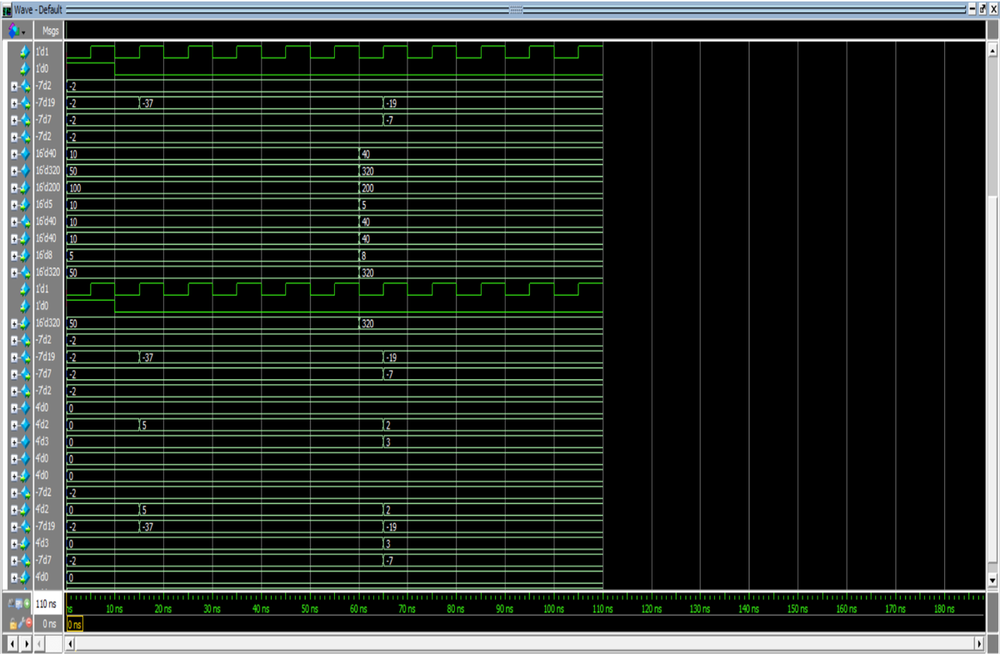

# Digital fuel pump: modular SystemVerilog design

**Oklahoma State University · ECEN 2233 Fundamentals of Digital Logic Design**

A small digital system that computes fuel needed and total cost and drives four seven-segment displays,
written as separate, reusable modules wired together in a top level and verified with a testbench in simulation.



## Architecture
```
distance ─┐
          ├─► fuel_needed_calculator ─► cost_calculator ─► display_fsm ─► 4 × seven_segment_display
efficiency┘     (distance / efficiency)   (× cost_per_liter)   (clocked BCD     (BCD → 7-segment
                                                                digit split)      decoder)
```

| Module | What it does |
|---|---|
| [`fuel_needed_calculator.sv`](src/fuel_needed_calculator.sv) | Signed 16-bit divide: fuel = distance / efficiency |
| [`cost_calculator.sv`](src/cost_calculator.sv) | Signed 16-bit multiply: cost = fuel × price |
| [`display_fsm.sv`](src/display_fsm.sv) | Clocked register stage with async reset; splits the cost into four decimal digits |
| [`seven_segment_display.sv`](src/seven_segment_display.sv) | Combinational BCD-to-seven-segment decoder (instantiated 4×) |
| [`top_level.sv`](src/top_level.sv) | Structural integration of the datapath |
| [`testbench.sv`](src/testbench.sv) | Clock generation, reset sequencing, two stimulus cases |

## Notes
- The source in `src/` was transcribed from the code screenshots in the [lab report](report.pdf). One fix was
  made: a missing comma after `.cost_per_liter(cost_per_liter)` in `top_level`'s port connections.
- Possible improvements: a counting animation state machine for the display, saturation/overflow checks on the
  16-bit multiply, and a self-checking testbench with `assert`s instead of waveform inspection.

**Skills:** SystemVerilog · RTL design · combinational and sequential logic · modular/hierarchical design ·
testbenches · waveform simulation
