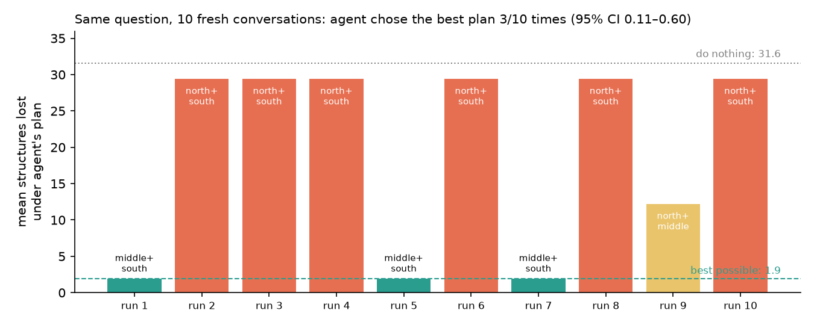

# Wildfire intervention study: controlled Monte Carlo experiments and AI-agent evaluation

**Texas State University · CADS "How to Build Agents for Research" workshop · October 2026**
Simulator and agent tools: workshop materials by **Aniruddha Bora**. Experiments, agent evaluation, notebook fixes and report: Daniel Shaheen.

**Question:** a fire starts west of a river; a town of 36 structures sits east of it. A crew can close **at
most two** of the three river crossings before the fire arrives. Which two, and how sure are we?

## Experimental design
- Probabilistic cellular-automaton fire model (Alexandridis et al. 2008 style), 48 × 72 one-hectare cells, with
  wind, slope, fuel dryness and ember spotting
- **100 Monte Carlo runs per condition** with a **fixed random seed** across conditions, so every option sees the
  same 100 fires and differences come from the intervention, not the noise
- Factors swept one at a time: wind direction (8), wind speed (2–12 m/s), dryness (0.6–1.3), and all
  7 permitted crossing-closure combinations
- Uncertainty on proportions reported with Wilson 95 % intervals

## Key results ([full table](RESULTS.md))

| Crossings closed | Mean structures lost (of 36) |
|---|---:|
| none (baseline) | 31.6 |
| north | 31.4 |
| south | 29.3 |
| middle | 12.6 |
| north + middle | 12.2 |
| north + south | 29.4 |
| **middle + south** | **1.9** |

- **Best plan: close middle + south**, a 94 % reduction in structures lost. Neither crossing alone comes close
  (south alone barely helps), so the effect depends on closing both together.
- Baseline: the fire reaches town in 96 of 100 runs (95 % CI 0.90–0.98).
- **Dryness dominates:** closing the middle crossing cuts losses to 0 % of baseline at dryness 0.6, but only to
  97 % of baseline at 1.3. The same intervention can be decisive or useless depending on conditions.

## Does an AI agent get it right? I tested it.
The workshop's agent is an LLM (Qwen 2.5 7B, run locally with Ollama) that writes Python to call the simulator
through narrow tools, with the two-crossing limit enforced **inside** the tool rather than by prompt instructions.
I ran it on every exercise and checked each answer against my own controlled results.

| Question | Correct answer | Agent's answer | What the trace shows |
|---|---|---|---|
| Most dangerous wind direction | East | south ✗ | Called the tool wrong, got errors, answered with no data |
| Is stronger wind worse? | Depends: more buildings lost, less area burned | "yes, more area" ✗ | Had the right numbers, read the trend backwards |
| Which crossings to close? | middle + south (1.9 lost) | north + south (29.4) ✗ | **Correct experiment, wrong reading of its own output** |
| Dryness limit for the middle closure | 0.9 | 1.3 ✗ | `.get(key, 0)` hid a bug and turned every value into 0 |
| Same crossing question, 10 fresh runs | — | **3 / 10 correct** (95 % CI 0.11–0.60) | In all 7 failures, the correct 1.9 was in the agent's own tool output |

**Takeaway:** a small agent can write a correct experiment and still draw the wrong conclusion, and a quiet
default value can turn a bug into a confident wrong answer. Independent checks on the same seeds caught every
error. Full analysis: [`RESULTS.md`](RESULTS.md) · notebook answers for each exercise.

### Fixes I made to the workshop notebook
- **`NameError` in Exercise 6:** the question was only defined inside an `if` block that was skipped when the agent was off
- **One agent switch**, set automatically by the connection test, instead of `RUN_AGENT = False` repeated in every cell
- **Sandboxed execution:** model-written code runs under macOS `sandbox-exec` with no network and no writes outside a temporary folder (the workshop's word-list guard alone is not a security boundary)
- **Stricter grading** in the 10-run test: checks the recommendation itself, not whether two words appear anywhere
- Consistent trace filenames for the hand-in

## Files
| File | Description |
|---|---|
| [`wildfire_assignment.ipynb`](wildfire_assignment.ipynb) | Completed notebook: all 7 exercises, executed, with agent traces printed |
| [`RESULTS.md`](RESULTS.md) | All numerical results: simulator checks and agent runs |
| `trace_ex1–4.json`, `trace_ex6_0–9.json`, [`exercise6_results.json`](exercise6_results.json) | Raw agent conversations and the 10-run reliability results |
| [`technical-report.pdf`](technical-report.pdf) | 3-page report on the simulation study (written before the agent runs) |
| [`fire_sim.py`](fire_sim.py), [`agent_tools.py`](agent_tools.py) | Workshop simulator and agent tool layer |

Running it yourself

**Locally (how the results here were produced):** install Ollama, run `ollama pull qwen2.5:7b-instruct` (~4.7 GB),
then run the notebook top to bottom. The agent switch turns on automatically when the model answers.

**Google Colab:** upload the notebook, `fire_sim.py` and `agent_tools.py`, then run the Colab setup cell first; it
installs Ollama inside the Colab machine and pulls the model. On Colab (Linux) the macOS sandbox isn't available.

The text-based code guard is an educational safeguard, not a security boundary: run generated code only in an isolated environment.

*Illustrative model for research education; not for real wildfire response decisions.*
