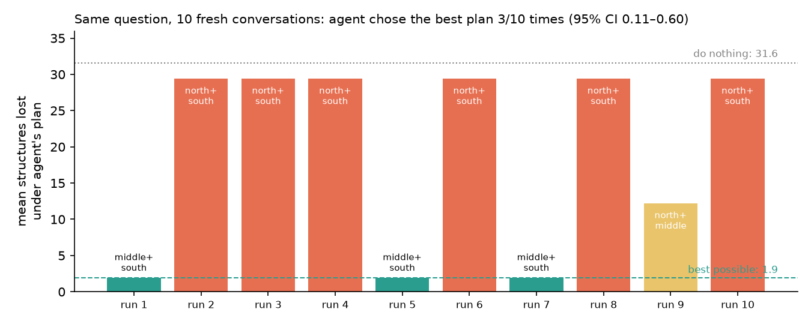

# Results: independent simulator checks and live agent runs

Computed using the supplied `fire_sim.py` and `agent_tools.py`, default `seed=0`, `n=100` fires per option. Results are model outputs, not empirical wildfire forecasts.

## Exercise 0: Baseline
- Mean town structures lost: **31.56 / 36**.
- Town reached: **96 / 100** runs; Wilson 95% interval **[0.90, 0.98]**.
- Mean area burned: **2536.7 hectares**.

## Exercise 1: Wind direction
- E: 31.6 structures lost
- SE: 21.9 structures lost
- S: 0.0 structures lost
- SW: 0.0 structures lost
- W: 0.0 structures lost
- NW: 0.0 structures lost
- N: 0.0 structures lost
- NE: 8.8 structures lost

## Exercise 2: Wind speed
- 2 m/s: 31.3 structures lost; 2655 ha burned
- 4 m/s: 31.8 structures lost; 2630 ha burned
- 6 m/s: 31.6 structures lost; 2536 ha burned
- 8 m/s: 32.3 structures lost; 2311 ha burned
- 10 m/s: 32.6 structures lost; 1999 ha burned
- 12 m/s: 33.5 structures lost; 1846 ha burned

## Exercise 3: Crossings closed
- none: 31.6 structures lost
- north: 31.4 structures lost
- middle: 12.6 structures lost
- south: 29.3 structures lost
- north+middle: 12.2 structures lost
- north+south: 29.4 structures lost
- middle+south: 1.9 structures lost

## Exercise 4: Dryness and closing the middle crossing
- 0.6: open=0.3, middle closed=0.0, ratio=0.00
- 0.7: open=8.0, middle closed=0.9, ratio=0.11
- 0.8: open=23.3, middle closed=5.0, ratio=0.21
- 0.9: open=31.6, middle closed=12.6, ratio=0.40
- 1.0: open=34.7, middle closed=20.8, ratio=0.60
- 1.1: open=35.5, middle closed=28.6, ratio=0.81
- 1.2: open=35.8, middle closed=31.8, ratio=0.89
- 1.3: open=35.9, middle closed=35.0, ratio=0.97

## Exercise 5: Flawed agent trace
The example trace compares only 4 of the 7 permitted options, uses 10 runs rather than 100 per option, and changes seeds between alternatives, making comparisons less controlled. Its conclusion is not established by a comprehensive controlled comparison.

## Agent runs (qwen2.5:7b-instruct via Ollama, Apple M4 Pro, 27 Nov 2026)

Every agent result below comes from the saved traces (`trace_ex*.json`, `exercise6_results.json`).

| Exercise | Correct (independent check) | Agent answered | Root cause seen in the trace |
|---|---|---|---|
| 1 Wind direction | E (31.6) | south ✗ | Passed integers 0–7 instead of compass names; `KeyError` on a guessed key; answered with no data |
| 2 Wind speed | Depends: loss ↑ 31.3→33.5, area ↓ 2655→1846 ha | "yes, area increases" ✗ | Printed the right numbers, then misread the trend; ignored building loss |
| 3 Crossings | middle + south (1.9) | north + south (29.4) ✗ | Correct, controlled experiment (all 7 options, n=100, seed=0), wrong reading of the output |
| 4 Dryness threshold | 0.9 (ratio 0.40) | 1.3, all ratios 0 ✗ | `.get('structures lost', 0)` hid a wrong key, so every value became 0 |

Common patterns: the model **guessed dictionary keys** (the tool docstrings don't list them), often wrote
`ANSWER:` **before** its code had run, and once it had numbers it **misread** them.

## Exercise 6: agent reliability (10 fresh conversations, Exercise 3's question)
- **3 of 10** recommended middle + south; **95 % Wilson interval 0.11–0.60**.
- Wrong picks: north + south ×6, north + middle ×1.
- In all 7 wrong runs, the tool output contained the correct 1.9 for middle + south.
- Grading checks the recommendation line itself (the workshop's anywhere-in-the-text check also gives 3/10 here).
- 8–9 s per run.

